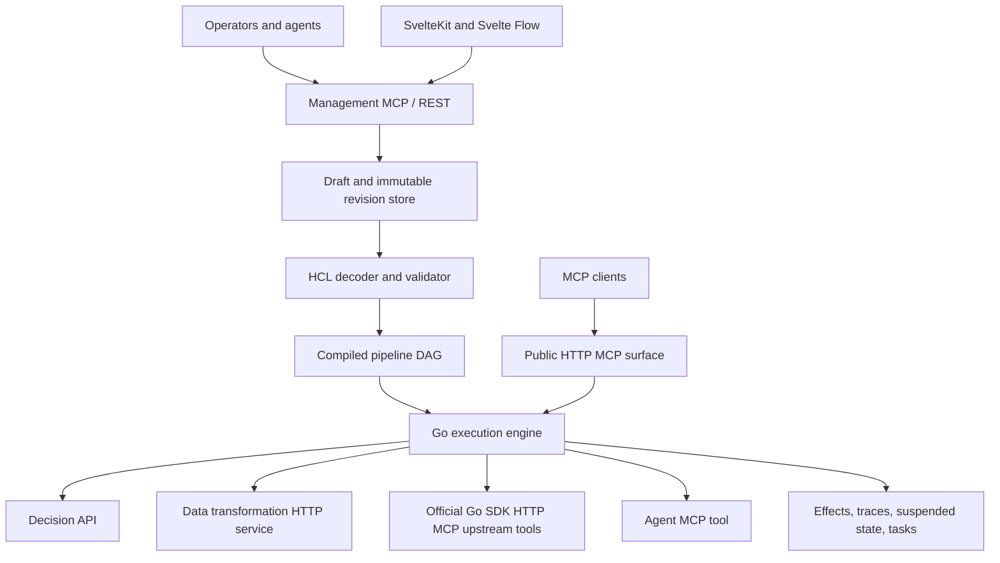

# Regate system architecture

## Purpose

Regate is a programmable MCP gateway. It bridges HTTP MCP upstreams, creates curated MCP surfaces for consumers, and exposes its own strictly separate authenticated management MCP. All published behavior is derived from a revisioned declarative source; UI geometry is independent.

## Boundaries

**Implemented prototype note:** a distinct `config.PipelineIR` holds typed output categories, static dependencies and precompiled CEL expressions. Dynamic remote JSON Schemas still require runtime verification. The runtime holds the active revision in a process-local R/W lock; longer-running runs capture their revision at start. The durable store is local disk files, not SQLite.

## Domain model

| Entity | Identity | Responsibilities |
|---|---|---|
| Upstream | `name` | HTTP MCP endpoint, auth environment variable, deadline |
| Catalog | upstream + observed timestamp | Discovered remote tools; cached in process |
| Hook | `name` | HTTP, MCP, built-in transform/decision/action |
| Policy | `name` | Decision hook; deny unless explicit allow |
| Pipeline | `name` | DAG of node names and conditional control edges |
| Surface | `name`, `path` | Exposed tools, resources, prompts |
| Interceptor | `name`, `stage`, order | Scoped cross-cutting handler |
| Revision | activation ID + digest | Immutable HCL snapshot; activation history |
| Draft | draft ID + base ID | Optimistic concurrent modification boundary |
| Run | run ID + revision | One execution and node results |
| Effect | effect ID | External dispatch attempt with uncertain outcome state |
| Task | task ID | Pollable async execution and input-required continuation |

## Execution sequence

1. Resolve request and surface, identify visible tool, snapshot active revision.
2. Apply `on_request` interceptors, fail-closed on error.
3. Direct tool: run `before_call`, invoke the specific upstream and apply `after_call`. Pipeline tool: resolve DAG and execute ready nodes in deterministic waves, bounded by `concurrency`.
4. Nodes may call remote MCP tools, HTTP hooks, decisions, built-in transformations; control edges can select routes.
5. For effects other than declared `read`, journal `dispatching` before dispatch, then `confirmed` or `unknown` after response. An uncertain outcome is **not** proof of failure.
6. Apply `before_response` interceptor and return JSON-RPC tool result. Preserve remote MCP payload where unchanged.
7. Save a trace. Admin can inspect it; `on_error` observers see a masked error summary and cannot change the result.

DAG constraints: no cycles, all nodes reachable from entry, all referenced hooks/policies/upstreams must exist. Current compiler does not prove fine-grained schema compatibility, effect safety or all control-flow join properties.

## Trust boundaries

- Management credentials never need to be forwarded to an upstream.
- Public surfaces and management endpoints have separate authentication checks.
- HTTP hosts require loopback or explicit HTTPS allowlisting.
- Decision API verdicts must explicitly say `allow`; `deny`, unknown and non-empty unfulfilled obligations abort.
- Revisions cannot be silently overwritten when the draft base no longer matches current active revision.
- Data owners define sensitive fields and permitted destinations. Regate
  applies configured authorization and field transformations before
  affected calls or responses. Personal-data masking is an example.
  [Sensitive data transfer contract](../contracts/hooks.md#sensitive-data-transfer)

## Failure semantics

A network failure after external dispatch is recorded as **unknown effect outcome**. Automatic retries of such actions are unsafe. An external reconciliation adapter (read-back matching, idempotency key, compensation) is required for full production support. The current engine records the uncertainty but does **not** implement generalized automated reconciliation.

The task handler persists progress and checkpoints. After a crash, unfinished `working` tasks are marked failed with an uncertain-outcome warning; automatic durable resume of every kind of external call is **not** guaranteed.

## External contracts

- Tool input: MCP JSON object, with metadata handled by the HTTP layer.
- Tool output: MCP content blocks / structured content and the JSON value used by transformations.
- HTTP hook input: `{ "input": <value> }`.
- HTTP transform output: `{ "action": "replace", "value": <value> }` or `{ "value": <value> }`.
- HTTP decision output: `{ "decision": "allow|deny" }`; non-empty `obligations` currently reject even on allow.
- Remote MCP hook: invokes a configured upstream tool with the input object (or `{ "input": ... }` for non-object).

See `docs/contracts/hcl.md` and `docs/contracts/hooks.md`.

## Upstream MCP transport (SDK milestone)

The upstream connector delegates transport negotiation, modern `server/discover`, legacy `initialize`, JSON-RPC and HTTP/SSE framing to `github.com/modelcontextprotocol/go-sdk/mcp` v1.8.0. This milestone does not replace the custom **inbound** public/admin MCP handler. The connector disables standalone SSE on its short-lived per-operation sessions and does not silently retry writes. The outbound HTTP transport remains DNS-pinned and credential injection is limited to one explicitly configured upstream; OAuth and persistent subscriptions require dedicated future work.
